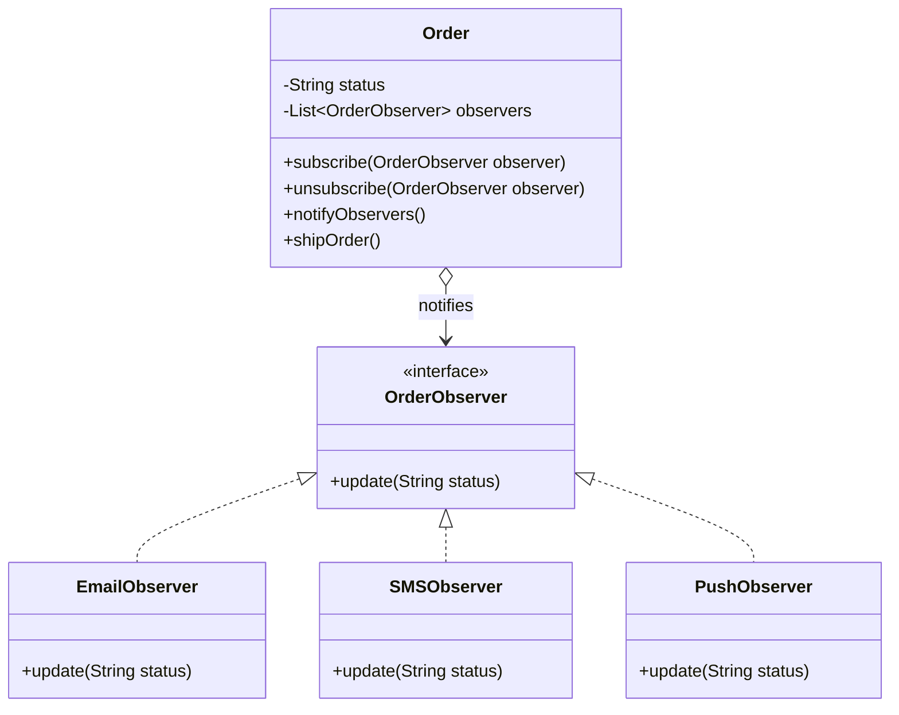

1. subject-observer
2. 1 to many relationship
-> List<YoutubeScriber> subscriberList=new ArrayList<>();

3. notifyScribers()
4. that  notifyScribers() should bu notify in channel class

# Observer Design Pattern

## 1. Overview

The **Observer Design Pattern** is a behavioral design pattern that establishes a one-to-many dependency between objects. When the state of a subject changes, all its registered observers are notified automatically.

**Intent:** Define a subscription mechanism to notify multiple dependent objects about state changes without tightly coupling them to the subject.

- **Category:** Behavioral Design Pattern
- **Primary goal:** Loose coupling between publishers and dependent objects
- **Key concept:** One-to-many notification
- **Common use cases:** Event systems, stock monitoring, order notifications, GUI listeners, and real-time dashboards

## 2. Real-World Example

Consider an e-commerce application.

When an order is shipped:
- Email Observer sends an email.
- SMS Observer sends a text message.
- Push Observer sends a push notification.

The order service does not need to know how each notification is delivered. It only notifies registered observers.

## 3. Problem Statement

Without the Observer Pattern, the subject may directly call every notification service.

```java
class OrderService {
    void shipOrder() {
        sendEmail();
        sendSMS();
        sendPushNotification();
    }
}
```

**Problems:**
- Tight coupling between business logic and notification services.
- Adding a notification type requires modifying existing code.
- Difficult unit testing and maintenance.
- Violates the intended separation of responsibilities.

## 4. UML Class Diagram



## 5. Participants

| Participant | Responsibility |
|---|---|
| Subject | Maintains observers and sends notifications |
| Observer | Defines the common update contract |
| Concrete Subject | Maintains state and triggers notifications |
| Concrete Observer | Implements a specific response |
| Client | Creates objects and registers observers |

## 6. Java Implementation

### Step 1: Observer Interface

```java
public interface OrderObserver {
    void update(String status);
}
```

### Step 2: Concrete Observers

```java
public class EmailObserver implements OrderObserver {
    @Override
    public void update(String status) {
        System.out.println("Email: Order is " + status);
    }
}
```

```java
public class SMSObserver implements OrderObserver {
    @Override
    public void update(String status) {
        System.out.println("SMS: Order is " + status);
    }
}
```

### Step 3: Subject

```java
import java.util.ArrayList;
import java.util.List;

public class Order {
    private final List<OrderObserver> observers =
            new ArrayList<>();

    private String status = "CREATED";

    public void subscribe(OrderObserver observer) {
        if (observer != null && !observers.contains(observer)) {
            observers.add(observer);
        }
    }

    public void unsubscribe(OrderObserver observer) {
        observers.remove(observer);
    }

    private void notifyObservers() {
        for (OrderObserver observer : List.copyOf(observers)) {
            observer.update(status);
        }
    }

    public void shipOrder() {
        status = "SHIPPED";
        notifyObservers();
    }
}
```

### Step 4: Main Class

```java
public class Main {
    public static void main(String[] args) {
        Order order = new Order();

        OrderObserver email = new EmailObserver();
        OrderObserver sms = new SMSObserver();

        order.subscribe(email);
        order.subscribe(sms);

        order.shipOrder();

        order.unsubscribe(sms);
        order.shipOrder();
    }
}
```

### Expected Output

```text
Email: Order is SHIPPED
SMS: Order is SHIPPED
Email: Order is SHIPPED
```

The second update reaches only the email observer because the SMS observer was unsubscribed.

## 7. Push vs. Pull Model

**Push Model:** The subject sends the updated data directly to observers.

```java
void update(String status);
```

**Pull Model:** The subject notifies observers, and observers retrieve the required state from the subject.

```java
void update(Order order);
```

Push is convenient when the event payload is known. Pull provides more flexibility when observers need different state information.

## 8. Advantages

- Reduces coupling between subject and concrete observers.
- Supports dynamic registration and unsubscription.
- Makes it easier to add new observers.
- Supports the Open/Closed Principle.
- Encourages programming to interfaces.

## 9. Disadvantages

- Notification order can affect behavior.
- Synchronous observers may block the subject.
- Exceptions can interrupt notification delivery.
- Forgotten subscriptions can cause memory leaks.
- Concurrent updates require appropriate synchronization.

## 10. Observer vs. Pub/Sub

| Observer | Publish–Subscribe |
|---|---|
| Often uses direct references to observers | Often uses an event bus or broker |
| Commonly used within one application | Can support distributed services |
| Frequently synchronous | Can be synchronous or asynchronous |
| Subject knows the observer abstraction | Publisher can be independent of subscribers |

These patterns are related, but they are not identical.

## 11. Observer vs. Strategy vs. Factory

| Pattern | Purpose | Example |
|---|---|---|
| Observer | Notify dependent objects | Order status notifications |
| Strategy | Select interchangeable behavior | Payment or pricing algorithms |
| Factory | Create appropriate objects | Payment processor creation |

## 12. SOLID Principles

- **SRP:** Separate state management from observer-specific behavior.
- **OCP:** Add observers without changing the notification loop.
- **LSP:** Concrete observers implement the common observer contract.
- **ISP:** Keep the observer interface focused on notification.
- **DIP:** The subject depends on the observer abstraction, not concrete notification classes.

## 13. Common Interview Questions

1. What is the Observer Design Pattern?
2. Why is it classified as a behavioral pattern?
3. What is the difference between Observer and Pub/Sub?
4. What are push and pull models?
5. Can observers subscribe or unsubscribe dynamically?
6. What happens if an observer throws an exception?
7. Is Observer always asynchronous?
8. How can the pattern cause memory leaks?
9. How does Observer support the Open/Closed Principle?
10. When should Observer be avoided?

## 14. Interview Summary

The Observer Pattern establishes a one-to-many relationship between a subject and its observers. When the subject changes state, it notifies registered observers through a common interface.

It is useful when multiple independent components must react to the same event without tightly coupling them to the event producer.

**Remember:** Observer is about notification, Strategy is about selecting behavior, and Factory is about object creation.
